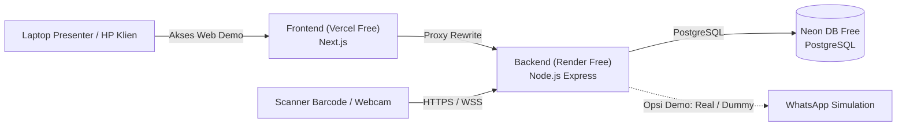

# Panduan Deployment PresenSee: Vercel (FE) + Render (BE) + Neon (DB)

Dokumen ini disusun khusus untuk kebutuhan **Demo, Portofolio, dan Presentasi ke Calon Klien / Sekolah**:
- **Biaya**: **100% GRATIS** (Memanfaatkan Free Tier Vercel, Render.com, dan Neon DB).
- **Tujuan**: Web bisa diakses online kapan saja saat presentasi, bisa dibuka dari HP / Laptop kepala sekolah, dan siap memamerkan seluruh fitur unggulan.

---

## 1. Arsitektur Demo (100% Free Tier)



---

## 2. Cara Memisahkan Backend dan Frontend (Pilih Salah Satu)

Aplikasi ini saat ini berstruktur **Monorepo** (terdapat folder `apps/api` untuk backend, `apps/web` untuk frontend, dan `packages/shared` untuk tipe data bersama).

Ada 2 cara untuk memisahkannya:

### Cara A (Sangat Direkomendasikan): Tetap 1 Folder / 1 Repositori GitHub

Anda **TIDAK PERLU memotong atau memindahkan folder apa pun di komputer Anda**. 
Folder di komputer Anda tetap dibiarkan seperti sekarang (1 project) dan di-push ke 1 repositori GitHub (misal: `github.com/akun-anda/presensee`).

Yang memisahkan eksekusinya adalah Vercel dan Render secara otomatis:
1. **Frontend di Vercel**:
   - Di Vercel ada kolom **Root Directory**, Anda klik **Edit** dan pilih: `apps/web`.
   - Vercel hanya akan memproses dan meng-compile frontend Next.js saja.
2. **Backend di Render**:
   - Hubungkan ke repositori GitHub yang sama.
   - Di kolom **Build Command**, Render diperintahkan hanya mem-build backend & shared:
     ```bash
     corepack enable && pnpm install --frozen-lockfile && pnpm --filter @siklon/shared build && pnpm --filter @siklon/api build
     ```
   - Di kolom **Start Command**:
     ```bash
     cd apps/api && node dist/server.js
     ```

> [!TIP]
> **Mengapa Cara A paling praktis?**
> Karena kedua aplikasi memakai paket bersama bernama `packages/shared` (berisi skema validasi Zod, aturan presensi, format tanggal). Dengan tetap 1 repositori, kode bersama ini langsung sinkron otomatis tanpa perlu upload package ke NPM.

---

### Cara B: Benar-benar Dipecah Menjadi 2 Folder / 2 Repo GitHub Terpisah

Jika Anda memang ingin memiliki 2 repositori mandiri di GitHub (misal `presensee-be` dan `presensee-fe`):

#### 1. Repositori Backend (`presensee-backend`)
Buat folder baru di komputer, lalu **salin berkas-berkas berikut**:
```text
presensee-backend/
├── apps/
│   └── api/                <-- Backend Express
├── packages/
│   └── shared/             <-- WAJIB IKUT (dibutuhkan oleh api)
├── database/               <-- Berisi schema.sql & seed.sql untuk Neon
├── package.json
└── pnpm-workspace.yaml
```
*(Folder `apps/web` dan `apps/scanner-agent` **dibuang / tidak usah disalin**)*.
Push folder ini ke repositori GitHub baru, misal: `github.com/akun-anda/presensee-backend`. Hubungkan Render ke repo ini.

#### 2. Repositori Frontend (`presensee-frontend`)
Buat folder baru di komputer, lalu **salin berkas-berkas berikut**:
```text
presensee-frontend/
├── apps/
│   └── web/                <-- Frontend Next.js
├── packages/
│   └── shared/             <-- WAJIB IKUT (dibutuhkan oleh web)
├── package.json
└── pnpm-workspace.yaml
```
*(Folder `apps/api` dan `database` **dibuang / tidak usah disalin**)*.
Push folder ini ke repositori GitHub baru, misal: `github.com/akun-anda/presensee-frontend`. Hubungkan Vercel ke repo ini dengan Root Directory diset ke `apps/web`.

---

## 3. Bagaimana dengan Scanner saat Aplikasi Dihosting di Cloud?

**Scanner tetap bisa digunakan 100%!** Arsitektur sistem ini memang sudah dirancang untuk cloud hosting:

### 1. Cara Scan Langsung di Web Browser (Paling Praktis untuk Demo)
- Buka web Anda di Vercel (misal `https://presensee-demo.vercel.app`), lalu buka menu **Konsol Scan**.
- **Memakai Scanner USB:** Colokkan kabel USB scanner ke laptop. Scanner barcode bekerja sebagai *Keyboard Input*, begitu kartu di-scan, nomor NIS terinput otomatis dan browser mengirim data ke API Render via HTTPS.
- **Memakai Kamera (Tanpa Alat):** Di menu Konsol Scan, klik izinkan akses webcam laptop atau kamera HP. Arahkan barcode kartu ke kamera, presensi langsung tercatat seketika.

### 2. Cara Scanner Agent (Untuk PC Gerbang Sekolah)
- Jika di sekolah ada PC khusus yang terhubung ke scanner serial/kabel COM, program `apps/scanner-agent` tetap dijalankan di PC gerbang sekolah tersebut.
- Buka file `config.json` di PC sekolah dan arahkan ke domain Render Anda:
  ```json
  {
    "apiUrl": "https://presensee-demo-api.onrender.com",
    "apiKey": "tempel-kunci-dari-menu-pengaturan-scanner"
  }
  ```
- **Kelebihan Fitur Offline Queue:** Jika internet di gerbang sekolah sempat putus, Scanner Agent otomatis menampung data scan di database lokal (SQLite di PC gerbang) dan otomatis mengirimkannya begitu internet kembali online!

---

## 4. Tips Krusial Agar Presentasi di Depan Klien Sukses & Anti-Macet

> [!IMPORTANT]
> ### 1. "Bangunkan" Server Render 3–5 Menit Sebelum Presentasi
> Layanan gratis Render akan **tidur (*spin down*)** jika tidak diakses selama 15 menit. Saat pertama kali dibuka setelah tidur, butuh waktu **±50 detik** untuk booting.
> **Tips Pro:** Sebelum masuk ke ruangan presentasi / sebelum demo dimulai, buka web Anda di browser HP sekali. Begitu server bangun, web akan merespons sangat cepat (*instant*) selama Anda presentasi.

> [!TIP]
> ### 2. Pilihan Mode WhatsApp untuk Demo
> Di file environment Render (`WA_PROVIDER`):
> - **Opsi A (`WA_PROVIDER=dummy`) — Paling Aman & Praktis:**
>   Pesan tetap tersusun rapi menggunakan template resmi sekolah, tercatat di tab *Log Pengiriman*, dan memiliki status pengiriman, tetapi **tidak benar-benar mengirim chat ke nomor fisik**. Sangat cocok untuk demo karena tidak perlu repot scan pairing QR setiap kali server bangun dari tidur, dan bebas risiko nomor demo terblokir.
> - **Opsi B (`WA_PROVIDER=baileys`) — Tampilkan Pesan Asli Masuk ke HP Klien:**
>   Jika Anda ingin memukau calon klien dengan mendemokan pesan masuk secara nyata ke nomor WhatsApp mereka:
>   1. Siapkan 1 nomor WhatsApp cadangan/khusus demo.
>   2. Buka tab **WhatsApp** di dashboard web sebelum presentasi, klik **Sambungkan**, lalu scan QR-nya.
>   3. Masukkan nomor HP klien di menu **Siswa** atau fitur **Kirim Pesan Uji** untuk membuktikan pesan masuk langsung ke HP mereka secara realtime!

---

## 5. Langkah 1: Setup Database Neon (Neon.tech)

1. Buka [neon.tech](https://neon.tech) dan login.
2. Buat project baru: misal `presensee-demo`.
3. Pilih Region: **Singapore (`ap-southeast-1`)**.
4. Salin connection string yang diberikan:
   ```text
   postgresql://[user]:[password]@[endpoint].ap-southeast-1.aws.neon.tech/neondb?sslmode=require
   ```
5. Buka tab **SQL Editor** di Neon:
   - Buka file `database/schema.sql`, salin seluruh isinya, paste ke SQL Editor, klik **Run**.
   - Buka file `database/seed.sql`, salin seluruh isinya, paste ke SQL Editor, klik **Run**.
   *(Database Anda sekarang sudah terisi contoh sekolah SMP Negeri 1 Contoh, kelas VII-A s/d IX-B, data siswa contoh, dan akun login superadmin).*

---

## 6. Langkah 2: Deploy Backend ke Render.com (Free Web Service)

1. Masuk ke [render.com](https://render.com) > **New +** > **Web Service**.
2. Hubungkan ke repositori GitHub proyek Anda.
3. Konfigurasi:
   - **Name**: `presensee-demo-api` (misal menghasilkan `https://presensee-demo-api.onrender.com`)
   - **Region**: `Singapore`
   - **Branch**: `main`
   - **Root Directory**: *(biarkan kosong jika pakai Cara A)*
   - **Runtime**: `Node`
   - **Plan**: `Free`
   - **Build Command**:
     ```bash
     corepack enable && pnpm install --frozen-lockfile && pnpm --filter @siklon/shared build && pnpm --filter @siklon/api build
     ```
   - **Start Command**:
     ```bash
     cd apps/api && node dist/server.js
     ```
4. Tambahkan **Environment Variables**:
   | Key | Value | Keterangan |
   |---|---|---|
   | `NODE_ENV` | `production` | |
   | `PORT` | `4000` | |
   | `TZ` | `Asia/Jakarta` | Waktu Indonesia Barat |
   | `DATABASE_URL` | `postgresql://...@ep-xxxx.neon.tech/neondb?sslmode=require` | Dari Neon DB |
   | `JWT_SECRET` | `demo-presensee-secret-key-super-secure-32chars` | Kunci token login |
   | `JWT_EXPIRES_IN` | `12h` | |
   | `SCANNER_API_KEY` | `demo-scanner-api-key-16chars` | |
   | `WA_PROVIDER` | `dummy` *(atau `baileys`)* | `dummy` direkomendasikan untuk demo santai |
   | `STORAGE_PATH` | `./storage` | |
   | `WA_SESSION_PATH` | `./storage/wa-session` | |
   | `CORS_ORIGINS` | `https://presensee-demo.vercel.app` | URL Vercel Anda |

5. Klik **Create Web Service**. Tunggu build selesai hingga log menampilkan `SIKLON API siap di http://localhost:4000/api/v1`.

---

## 7. Langkah 3: Deploy Frontend ke Vercel (Free Hobby Plan)

1. Buka [vercel.com](https://vercel.com) > **Add New...** > **Project**.
2. Pilih repositori GitHub proyek ini.
3. Konfigurasi:
   - **Root Directory**: Klik **Edit** dan pilih folder: `apps/web`.
4. Tambahkan **Environment Variables**:
   - `NEXT_PUBLIC_API_URL`: `https://presensee-demo-api.onrender.com/api/v1`
5. Klik **Deploy**.
6. Selesai! Web Anda kini aktif di URL Vercel (misal: `https://presensee-demo.vercel.app`).

---

## 8. Langkah 4: Sambungkan Cookie Autentikasi (Agar Tidak Mental ke Login)

Agar login di browser demo tidak terblokir cross-domain:
Tambahkan aturan `rewrites` di `apps/web/next.config.mjs`:

```javascript
/** @type {import('next').NextConfig} */
const nextConfig = {
  async rewrites() {
    return [
      {
        source: '/api-backend/:path*',
        destination: 'https://presensee-demo-api.onrender.com/api/v1/:path*',
      },
    ];
  },
};

export default nextConfig;
```
Dan di Environment Variable Vercel, ubah `NEXT_PUBLIC_API_URL` menjadi:
`https://presensee-demo.vercel.app/api-backend`

---

## 9. Skenario / Demo Flow yang Menarik untuk Dipresentasikan ke Sekolah

Saat presentasi di depan kepala sekolah / yayasan, gunakan urutan demo berikut:

1. **Buka Dashboard Utama**:
   - Tunjukkan metrik realtime: Siswa Hadir, Terlambat, Izin/Sakit, dan Belum Hadir.
2. **Pamerkan Konsol Scan Realtime**:
   - Tunjukkan tampilan layar gerbang sekolah: saat ada scan, nama dan status siswa muncul seketika beserta bunyi bel presensi.
3. **Pamerkan Fitur Ubah Status & Opsi Notifikasi WhatsApp**:
   - Buka menu **Kelola Presensi**.
   - Pilih satu siswa yang belum hadir, klik **Ubah Status**.
   - Tunjukkan tombol status baru (`IZIN` / `SAKIT`) dan radio button:
     *"Kirim notifikasi WhatsApp ke wali murid? (Tidak / Ya)"*.
   - Jelaskan bahwa guru/admin punya kendali penuh apakah perubahan status ingin dikabarkan ke orang tua atau tidak.
4. **Pamerkan Auto ALPA**:
   - Tunjukkan bahwa sekolah tidak perlu mengabsen manual satu per satu: sistem otomatis menandai siswa yang belum hadir pada jam batas alpa (misal jam 09:00).
5. **Pamerkan Laporan Otomatis (Excel & PDF)**:
   - Klik tombol **Lihat PDF** di Laporan Harian atau Bulanan.
   - Tunjukkan cetakan PDF yang sudah rapi dengan kop sekolah, siap tanda tangan kepala sekolah.
